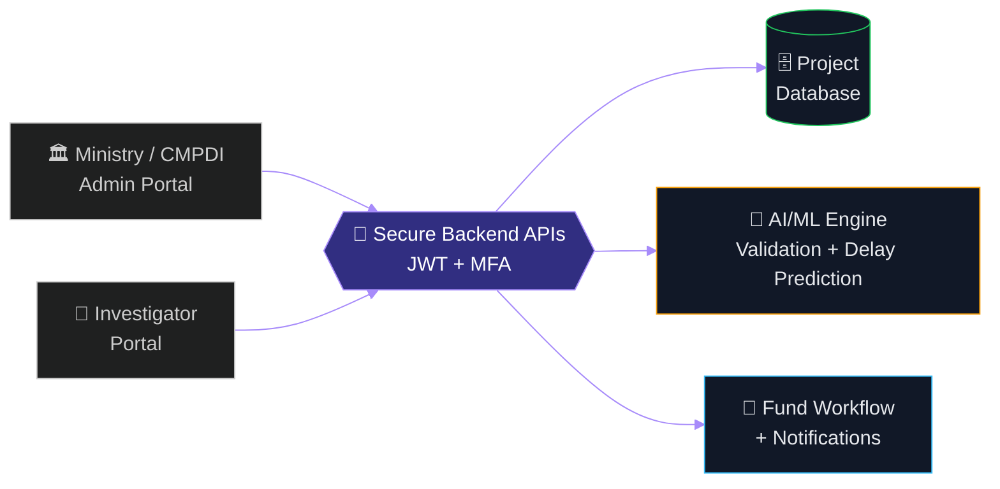
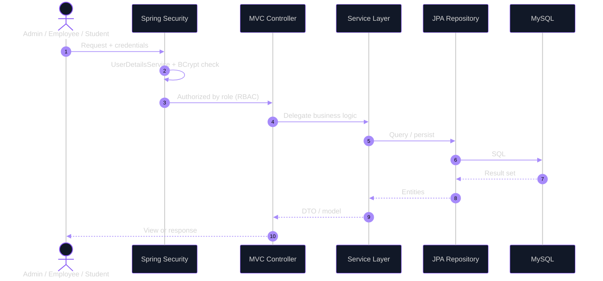

<div align="center">


<br/>

<a href="https://github.com/YOUR_GITHUB_USERNAME"></a>


<!--  -->

</div>

<br/>

```text
┌──(atharva㉿devbox)-[~]
└─$ neofetch --profile

   ▄▄▄▄▄▄▄▄▄▄▄▄▄     atharva@devbox
   █ ▀▄ ▄▀ ▄▀▄ █     ──────────────────────────────────────────
   █  ▄▀▄  █▄█ █     role     Java Developer · Backend Engineering
   █ ▄▀ ▀▄ █ █ █     edu      B.Tech IT · SPPU · CGPA 8.08 · May 2027
   ▀▀▀▀▀▀▀▀▀▀▀▀▀     core     Java · Spring Boot · REST APIs · SQL
                     rank     SIH 2024 Champion · IDE Bootcamp Top 1%
                     lead     Team Lead @ Superiors Technology
                     motto    learn deeply · build deliberately · ship responsibly
```

---

## `00 // BOOT SEQUENCE`

```text
[  OK  ] Mounted      /dev/curiosity ............ read-write
[  OK  ] Loaded       module java ............... Spring Boot, MVC, Data JPA
[  OK  ] Loaded       module security ........... JWT · BCrypt · RBAC · MFA
[  OK  ] Started      team-lead.service ......... 5 members, 1 national win
[  OK  ] Reached      target backend-engineering.target
[ .... ] Running      learning.daemon ........... microservices, system design
```

---

## `01 // ABOUT`

Hey, I'm **Atharva Ughade**, an Information Technology student at Savitribai Phule Pune University, building my path in **backend engineering**.

I like understanding how systems fit together: clear layers, secure access, code that stays maintainable, and software that is useful to real people. My experience spans Java/Spring application development, AI automation, and leading the team behind a national hackathon-winning project.

```java
public final class AtharvaUghade implements Developer {

    private final String role         = "Java Developer";
    private final String focus        = "Backend Engineering";
    private final String[] stack      = {"Java", "Spring Boot", "REST", "SQL"};
    private final String milestone    = "Smart India Hackathon 2024 Champion";
    private final String mindset      = "Learn deeply. Build deliberately. Ship responsibly.";

    @Override
    public Software build(Problem problem) {
        return design(problem).secure().test().ship();
    }
}
```

---

## `02 // ACHIEVEMENTS UNLOCKED`

<div align="center">

| 🏆 `LEVEL 1` | 💎 `LEVEL 2` | 🚀 `LEVEL 3` |
|:---:|:---:|:---:|
| **SIH 2024 Champion** | **IDE Bootcamp Prize** | **Top 1% Innovator** |
| 1st place · NIT Surathkal | ₹5,00,000 | IDE Bootcamp |
| BLACKGOLD · ₹1,00,000 prize | Innovation, Design & Entrepreneurship | National recognition |

</div>

> **Note:** BLACKGOLD won first place and a ₹1,00,000 prize at Smart India Hackathon 2024 (NIT Surathkal). The ₹5,00,000 prize and Top 1% recognition are from the separate IDE Bootcamp.

---

## `03 // PROJECTS`

<details open>
<summary><b><code>01</code> &nbsp;BLACKGOLD · Coal Project Monitoring Platform</b></summary>

<br/>


A secure digital platform built under **Smart India Hackathon 2024** for the **Ministry of Coal, Government of India**, replacing paper-based science and technology / R&D project monitoring with a digital workflow.

**Mission brief**
- Dual-portal architecture for Ministry/CMPDI administrators and project investigators
- Real-time project tracking with automated fund-workflow support
- AI/ML-assisted delay prediction and data-validation analytics
- JWT authentication, multi-factor authentication, and push notifications
- Cloud deployment on AWS/Azure

**My role:** led a five-member team to **1st place at NIT Surathkal**.



🔗 **Repository:** [Add the BLACKGOLD repository or public project link](https://github.com/YOUR_GITHUB_USERNAME)

</details>

<details open>
<summary><b><code>02</code> &nbsp;EdTech Platform · Course, Employee &amp; Student Management</b></summary>

<br/>


A multi-role EdTech application covering course sales, inquiries, follow-ups, and user management across **Admin, Employee, and Student** modules.

**System design**
- **Controller → Service → Repository** layering with constructor injection for loose coupling and testability
- Spring Security with a custom `UserDetailsService`, BCrypt password encoding, and role-based access control
- Admin dashboard with sales tracking, customer management, feedback handling, charts, and paginated course CRUD
- Payment gateway integration



🔗 **Repository:** [Add the EdTech project repository](https://github.com/YOUR_GITHUB_USERNAME)

</details>

---

## `04 // STACK LOADOUT`

> A **technology map**, not a proficiency score.

<div align="center">


</div>

| Slot | Gear equipped |
|---|---|
| ⚔️ **Languages** | `Java` `JavaScript` `SQL` |
| 🛡️ **Backend** | `Spring Boot` `Spring MVC` `REST APIs` `Hibernate` `Spring Data JPA` |
| 🔐 **Security** | `Spring Security` `JWT` `BCrypt` `Role-Based Access Control` `MFA` |
| 🗄️ **Databases** | `MySQL` `MongoDB` |
| 🧰 **Tooling** | `Maven` `Gradle` `Git` `GitHub` `Postman` `IntelliJ IDEA` `Eclipse` |
| ☁️ **Cloud** | `AWS` `Azure` |
| 🧪 **Side quests** | `Microservices Architecture` `AI/ML Integration` `n8n` `Vapi` `AI Agents` |

---

## `05 // COMMIT HISTORY`

```text
$ git log --graph --oneline --decorate

* 9f3c2a1 (HEAD -> main) feat: backend engineer in progress
|           Java · Spring Boot · REST · SQL · microservices
|
* 7be41d0 feat: Team Lead @ Superiors Technology       [Nov 2024 → Feb 2026]
|           n8n · Vapi · AI agents for startups, SMEs, manufacturing
|
* 4ad9c88 feat: BLACKGOLD ships, SIH 2024 Champion     [NIT Surathkal]
|           5-member team · Ministry of Coal · 1st place
|
* 1c05e7f init: B.Tech IT @ SPPU                       [expected May 2027]
```

### Team Lead · Superiors Technology
`November 2024 — February 2026` · Pune, India

- Led a core team delivering AI automation solutions with **n8n, Vapi, and AI agents** for startups, SMEs, and manufacturing businesses.
- Built AI-assisted outbound workflows for personalized cold email and direct-message lead generation.
- Supported brand growth for healthcare and hospitality clients through AI-assisted content strategy, paid marketing, and social media campaigns.

---

## `06 // GITHUB TELEMETRY`

<div align="center">


<br/>


<br/>


</div>

<sub>Cards are generated from public GitHub data via third-party services and may take a moment to load.</sub>

---

## `07 // OUTSIDE THE TERMINAL`

```text
$ cat leadership.log

[ROLE]  Vice President   · IT Department, Young Inspirators Network
[ROLE]  Marketing Lead   · E-Cell RSCOE
[EVENT] Startup activities · E-Summit 2025
[BELIEF] Good engineering = technical depth + communication + ownership + teamwork
```

---

## `08 // CONNECT`

<div align="center">

<a href="https://www.linkedin.com/"></a>
<a href="mailto:atharvaughade78@gmail.com"></a>
<a href="https://github.com/YOUR_GITHUB_USERNAME"></a>

<br/><br/>

```text
╭────────────────────────────────────────────╮
│ [ SYSTEM STATUS ]   learning      : ACTIVE │
│ [ BUILD STATUS  ]   projects      : RUNNING│
│ [ NEXT OBJECTIVE]   stronger backend engineer │
╰────────────────────────────────────────────╯
```

**"Build things that work. Understand why they work. Make them matter."**


</div>
