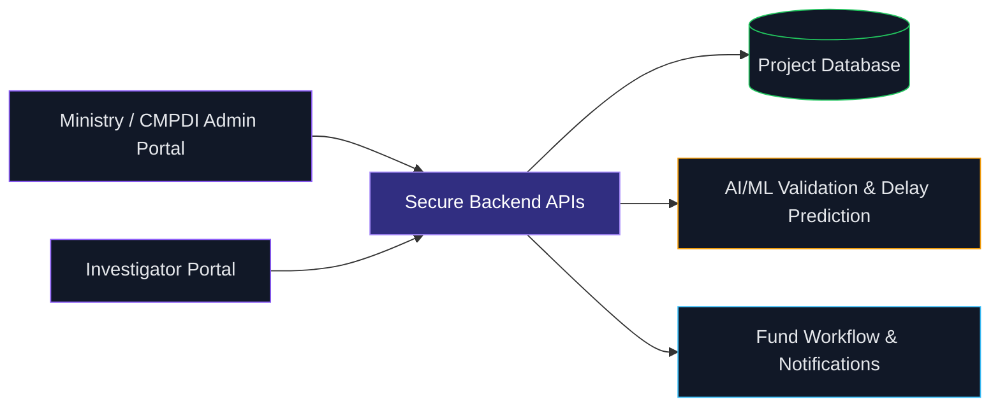
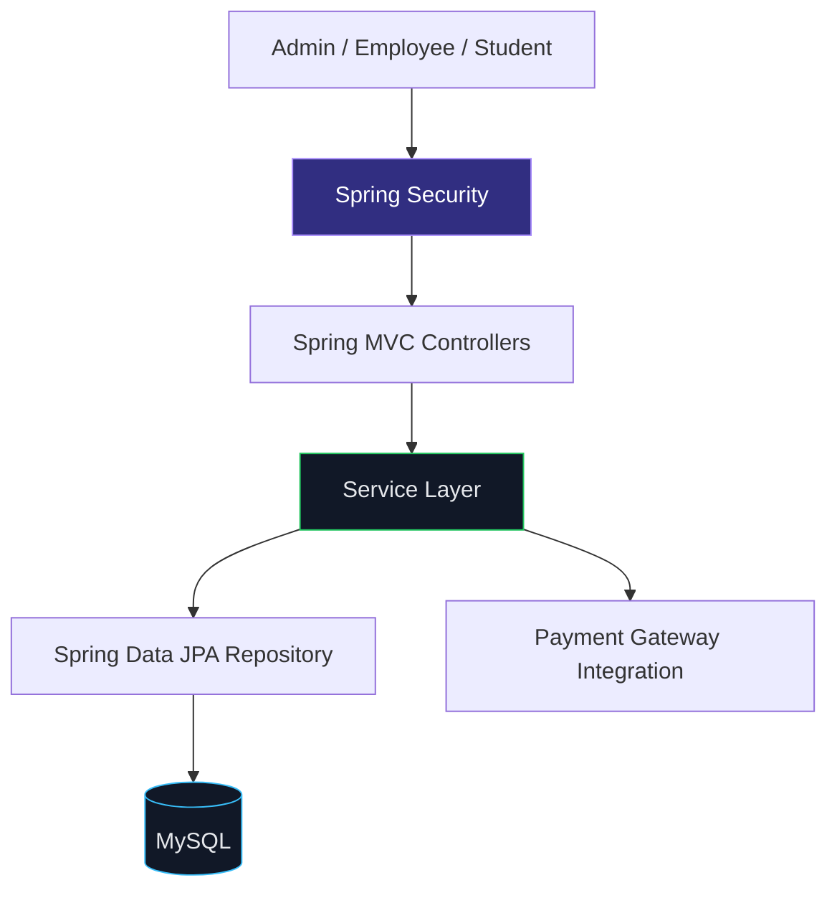

<div align="center">


<br/>


<br/>

<a href="https://github.com/YOUR_GITHUB_USERNAME"></a>


</div>

```bash
┌──(atharva㉿devbox)-[~/profile]
└─$ whoami
Java developer • B.Tech IT • Team Lead • SIH 2024 Champion
```

## `01 / ABOUT`

Hey, I'm **Atharva Ughade**, an Information Technology engineering student at Savitribai Phule Pune University, building my path in backend engineering.

I enjoy designing practical applications, understanding how systems fit together, and working with teams to turn complex problems into useful software. My experience spans Java/Spring application development, AI automation, and leading a team behind a national hackathon-winning project.

- **Currently focused on:** Java, Spring Boot, REST APIs, SQL, and backend fundamentals
- **Engineering mindset:** clear layers, secure access, maintainable code, real-world utility
- **Leadership:** Team Lead at Superiors Technology; led a five-member team on BLACKGOLD
- **Education:** B.Tech in Information Technology · CGPA 8.08/10 · Expected May 2027

```java
public final class AtharvaUghade {
    String role = "Java Developer";
    String currentFocus = "Backend Engineering";
    String mindset = "Learn deeply. Build deliberately. Ship responsibly.";
    String milestone = "Smart India Hackathon 2024 Champion";
}
```

## `02 / IMPACT LOG`

<div align="center">

| `01` | `02` | `03` |
|:---:|:---:|:---:|
| **1st Place** | **₹5,00,000** | **Top 1%** |
| SIH 2024 · NIT Surathkal | IDE Bootcamp prize | National innovators recognition |
| BLACKGOLD project | Innovation, Design & Entrepreneurship Bootcamp | IDE Bootcamp |

</div>

> **Recognition:** BLACKGOLD secured first place and a ₹1,00,000 prize at NIT Surathkal during Smart India Hackathon 2024. Separately, the IDE Bootcamp achievement included a ₹5,00,000 prize and recognition among the top 1% of innovators nationally.

## `03 / PROJECTS`

### `01` BLACKGOLD — Coal Project Monitoring Platform
**Node.js · Express.js · MongoDB · Python · JWT · AWS/Azure**

A secure digital platform developed under **Smart India Hackathon 2024** for the Ministry of Coal, Government of India, to digitize science and technology / R&D project monitoring and replace paper-based workflows.

**What it does**
- Dual-portal architecture for Ministry/CMPDI administrators and project investigators
- Real-time project tracking and automated fund-workflow support
- AI/ML-assisted delay prediction and data-validation analytics
- JWT authentication, multi-factor authentication, and push notifications
- Cloud deployment on AWS/Azure

**My role:** Led a five-member team that secured **1st place at NIT Surathkal**.



**Repository:** [Add the BLACKGOLD repository or public project link](https://github.com/YOUR_GITHUB_USERNAME)

---

### `02` EdTech Platform — Course, Employee & Student Management
**Java · Spring Boot · Spring MVC · Spring Security · Spring Data JPA · MySQL · Payment Gateway**

A multi-role EdTech application covering course sales, inquiries, follow-ups, and user management through Admin, Employee, and Student modules.

- Structured the application with **Controller → Service → Repository** layers
- Used constructor injection to support loose coupling and testability
- Implemented Spring Security with a custom `UserDetailsService`, BCrypt password encoding, and role-based access control
- Built an admin dashboard with sales tracking, customer management, feedback handling, charts, and paginated course CRUD



**Repository:** [Add the EdTech project repository](https://github.com/YOUR_GITHUB_USERNAME)

## `04 / SKILL MATRIX`

A snapshot of the technologies used in my projects and current engineering focus. This is a **technology map, not a proficiency score**.

| Area | Stack / Concepts |
|---|---|
| **Languages** | `Java` `JavaScript` `SQL` |
| **Backend** | `Spring Boot` `Spring MVC` `REST APIs` `Hibernate` `Spring Data JPA` |
| **Security** | `Spring Security` `JWT` `BCrypt` `Role-Based Access Control` `MFA` |
| **Databases** | `MySQL` `MongoDB` |
| **Build & Developer Tools** | `Maven` `Gradle` `Git` `GitHub` `Postman` `IntelliJ IDEA` `Eclipse` |
| **Cloud & Delivery** | `AWS` `Azure` |
| **Exploring / Foundational** | `Microservices Architecture` `AI/ML Integration` `n8n` `Vapi` `AI Agents` |

<div align="center">


</div>

## `05 / EXPERIENCE`

### Team Lead · Superiors Technology
`November 2024 — February 2026` · Pune, India

- Led a core team delivering AI automation solutions with **n8n, Vapi, and AI agents** for startups, SMEs, and manufacturing businesses.
- Built AI-assisted outbound workflows for personalized cold email and direct-message lead generation.
- Supported brand growth for healthcare and hospitality clients through AI-assisted content strategy, paid marketing, and social media campaigns.

## `06 / GITHUB TELEMETRY`

<div align="center">


<br/>


<br/>


</div>

<sub>These cards are generated from public GitHub activity and repository data. They may take time to load and depend on third-party services.</sub>

## `07 / OUTSIDE THE TERMINAL`

**Leadership · Entrepreneurship · Collaboration**

Beyond code, I've worked on student leadership, startup events, and AI-powered business solutions. I served as Vice President for the IT department's Young Inspirators Network and as Marketing Lead at E-Cell RSCOE, and contributed to startup-focused activities at E-Summit 2025.

I believe good engineering combines technical depth with communication, ownership, and teamwork.

## `08 / CONNECT`

<div align="center">

<a href="https://www.linkedin.com/"></a>
<a href="mailto:atharvaughade78@gmail.com"></a>
<a href="https://github.com/YOUR_GITHUB_USERNAME"></a>

<br/><br/>

```text
[ SYSTEM STATUS ]  Learning: ACTIVE
[ BUILD STATUS  ]  Projects: IN PROGRESS
[ NEXT OBJECTIVE]  Become a stronger backend engineer
```

**“Build things that work. Understand why they work. Make them matter.”**

</div>
